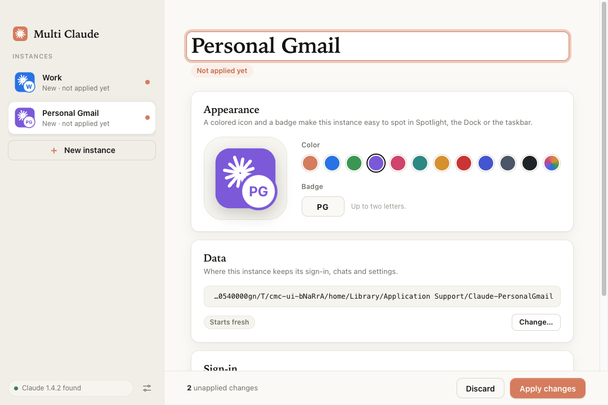
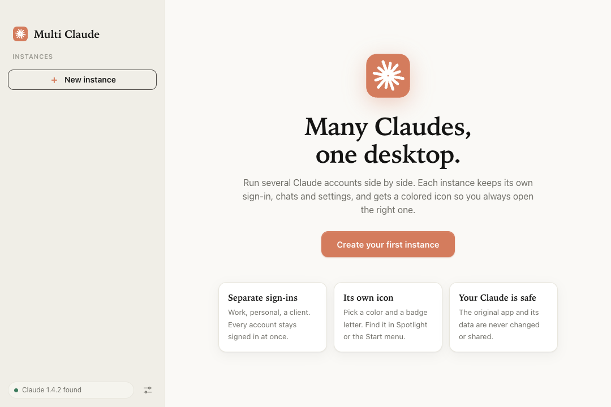
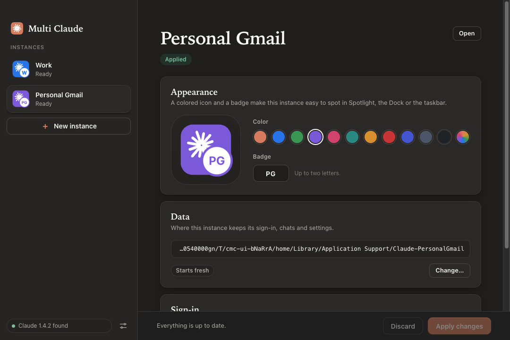

<div align="center">

# MuClaude

**Run several Claude Desktop and Claude Code accounts side by side.**<br>
Personal, work, client: each with its own sign-in, chats and settings, and its own colored icon so you always open the right one.

[](https://github.com/Aplex2723/muClaude/releases/latest)
[](https://github.com/Aplex2723/muClaude/actions/workflows/ci.yml)
[](LICENSE)

[](https://github.com/Aplex2723/muClaude/stargazers)



</div>

## Why MuClaude

Claude Desktop only lets you be signed in to one account. Switching means signing out and back in, and losing your place.
MuClaude gives every account its own isolated profile and its own launcher, so they run **at the same time**.

- **One click to open.** Double-click an instance to launch it. Single-click to choose **Open** or **Edit**.
- **Impossible to mix up.** Each instance gets a colored icon and a badge (initials or emoji) in the Dock, taskbar and app switcher.
- **Nothing shared.** Separate sign-ins, chats and settings per instance.
- **Safe by design.** On macOS your real `Claude.app` is never modified. Launchers are tiny apps in `~/Applications`.
- **Looks like it belongs.** Anthropic-style ivory and coral design, with light and dark mode.
- **Cleanly reversible.** Remove an instance and its launcher, and optionally its data, from the same window.

| Welcome | Dark mode |
| --- | --- |
|  |  |

## Install

### macOS (Apple Silicon)

1. Download **`MuClaude-x.y.z-arm64.dmg`** from the [latest release](https://github.com/Aplex2723/muClaude/releases/latest).
2. Open it and drag **MuClaude** to Applications.
3. First launch only: **right-click the app, choose Open**, then confirm. (The app is ad-hoc signed, not notarized, so macOS asks once.)

### Windows

Download the installer or the portable `.exe` from the [latest release](https://github.com/Aplex2723/muClaude/releases/latest).
Windows support is newer and less tested than macOS; please [report anything odd](https://github.com/Aplex2723/muClaude/issues/new/choose).

### From source

```bash
git clone https://github.com/Aplex2723/muClaude.git
cd muClaude/desktop
npm install
npm run dev             # build the macOS sign-in helper and run from source
npm run install:mac     # build MuClaude.app and copy it into /Applications
```

Requires [Claude Desktop](https://claude.ai/download) to be installed.

## Claude Code profiles (macOS)

Install [Claude Code](https://code.claude.com/docs/en/setup) and Node.js 18+, then open **Claude Code** in MuClaude and click **Add muclaude to PATH**. It links the `muclaude` command into `~/.local/bin` and adds that folder to your shell's startup file (`~/.zshrc` for zsh, `~/.bash_profile` for bash, `conf.d/muclaude.fish` for fish) inside a marked `# >>> MuClaude >>>` block. Open a new terminal afterwards.

From a checkout, the same thing from the command line:

```bash
cd desktop
npm run install:cli -- --add-to-path
```

Without `--add-to-path` only the link is created; put `~/.local/bin` first on your `PATH` yourself:

```bash
export PATH="$HOME/.local/bin:$PATH"  # add this to ~/.zshrc for new terminals
```

From **any directory**, in two terminals:

```bash
muclaude code x
muclaude code y
```

Each name creates a fresh profile on its first launch. Sign in to its **claude.ai account** when Claude asks. Both sessions use their terminal's current directory and can edit the same worktree at once. MuClaude's window can be closed; no background MuClaude service is needed. No worktrees are created and no Git conflict handling is added.

The macOS window also has **Claude Code profiles** to create/list profiles and install the terminal command. Code profiles are independent of Desktop instances.

```bash
muclaude code list
muclaude code create client
muclaude code path x
muclaude code x auth login
muclaude code x auth status
muclaude code x --resume
```

Profile names are lowercase, start with a letter or number, and contain at most 40 letters, numbers, `_` or `-`. `create`, `list` and `path` are reserved. Claude arguments are passed directly without shell interpretation; an optional `--` after the profile separates them. `--settings` is reserved for MuClaude's memory override.

| Data | Location / sharing |
| --- | --- |
| Account, Claude credentials, conversations, prompt history, caches, automatic memory, MCP OAuth | Private `~/Library/Application Support/MuClaude/code/profiles/<name>`; Claude's macOS Keychain identity also depends on `CLAUDE_CONFIG_DIR` |
| Global skills and authored configuration | Links to `~/.claude/skills`, `commands`, `agents`, `rules`, `hooks`, `output-styles`, `themes`, `CLAUDE.md`, `keybindings.json` |
| Personal preferences | Selected fields copied from `~/.claude/settings.json` and an explicit UI-preference allowlist in `~/.claude.json` at launch; changes saved by Claude propagate back on normal exit |
| User MCP definitions | Only `mcpServers` from `~/.claude.json`, synchronized with preferences; OAuth tokens and project trust stay private |
| Worktree | The existing code, pending edits, Git, `CLAUDE.md`, `.claude/` and `.mcp.json`, unchanged and shared |

Install skills once, using the usual command **outside a profile session**:

```bash
npx skills add <repository> -a claude-code -g
```

The linked directory makes newly installed skills immediately available to all profiles. No copying or reinstalling is needed. Plugin installations and plugin account data remain private; this release shares standalone global skills, not plugin installations.

Shared configuration refreshes at each launch. Preference/MCP edits made inside Claude propagate on normal exit; another already-running session picks them up on its next launch. Concurrent edits to different preferences or different MCP servers are merged, and a conflict in the same preference/server keeps the newer shared value and prints a warning. An interrupted/crashed wrapper leaves edits in the private profile; the next launch reconciles them before refreshing shared configuration. Configuration is never synchronized by linking the whole `.claude` directory or `.claude.json`.

Claude credential helpers, login restrictions, provider credentials/routing and custom memory paths are excluded from shared preferences. Inherited Claude authentication/provider variables are removed before launch; profile-local credentials remain available. MCP definitions can include literal headers or environment values, which are shared as part of those definitions; use MCP OAuth for separate service sign-ins. MuClaude supplies a profile/repository-specific `autoMemoryDirectory` at CLI precedence so a project setting cannot merge account memories. Organization-managed settings still take precedence. Shared hooks and instructions remain user-authored code and can reference any files you give them access to; this is configuration separation, not an OS sandbox.

This uses Claude's [documented multiple-account support](https://code.claude.com/docs/en/authentication#log-in-with-multiple-accounts). Claude Console sign-ins **without an API key** are stored outside the configuration directory and are not isolated by Claude's mechanism; use claude.ai accounts or a profile-local API key instead. No existing sign-in is imported automatically. Fresh profiles require their own login.

The installer refuses to replace a command it did not create. It does replace its own earlier link (for example after moving the app or deleting the checkout it pointed to). To deliberately replace someone else's command while keeping a backup, use `npm run install:cli -- --bin-dir /absolute/bin/path --replace`.

### Uninstall

Click **Uninstall…** in the **Claude Code profiles** window, or run:

```bash
muclaude uninstall                 # asks whether to delete profile data
muclaude uninstall --keep-data     # only removes the command
muclaude uninstall --delete-data --yes
```

The command is removed only if it is a MuClaude link, and the `# >>> MuClaude >>>` PATH block is removed from your shell startup files. With data deletion, each profile is signed out through `claude auth logout` (clearing its Keychain entry) and `~/Library/Application Support/MuClaude/code` is deleted, including accounts, history and automatic memory. `~/.claude` (skills, settings), `~/.claude.json`, Desktop instances and Google sign-in data are never touched. Close running `muclaude code` sessions first, then move MuClaude.app to the Trash. If Claude Code is not on PATH, profiles are still deleted but a sign-in may remain in Keychain Access.

When working from a checkout, `npm run dev` provides a `muclaude-dev` command for as long as the dev server runs and removes it when the server stops, so no link to a short-lived worktree is left behind. It never touches `muclaude`.

## How it works

| | macOS | Windows |
| --- | --- | --- |
| Launcher | small `Claude <Name>.app` in `~/Applications` | `.lnk` shortcuts (Desktop, Start menu) |
| Isolation | `open -na Claude.app --args --user-data-dir=<profile>` | patched copy of Claude with its own profile |
| Your original Claude | never touched | never touched |

Profiles live in `~/ClaudeInstances`. Deeper notes on the security model and edge cases are in [desktop/README.md](desktop/README.md).

### Google sign-in in Desktop instances (macOS)

Select an instance in MuClaude and click **Sign in with Google**, then click **Continue with Google** in that Claude window. MuClaude temporarily routes `claude://` browser returns to that running profile, preserving Claude's own sign-in validation. Other instances can stay open. macOS may ask to allow MuClaude Sign-in to handle Claude links.

Click **Done / Cancel routing** once signed in. Routing also ends after a browser return, on closing MuClaude or the selected Claude process, or after 15 minutes, and restores the previous link handler. If Claude completes authentication through its native macOS auth session, click Done to end routing. The original Claude app and profile data are not modified; callback codes are forwarded in memory and never saved. This routing helper currently supports macOS only.

## FAQ

**Is this allowed?** It is an independent community tool and is **not affiliated with, endorsed by, or supported by Anthropic**. It launches the official app with separate profiles; check your organization's policies before using it with a work account.

**Will my existing chats survive?** Yes. Existing profiles can be adopted, and chats stay in the profile folder. Nothing is uploaded anywhere, and MuClaude blocks all network access from its own window.

**Does it work with the old Python tool's instances?** Yes, MuClaude reads and writes the same `instances.json` manifest.

**Why does macOS say the app is from an unidentified developer?** It is not notarized yet. Right-click, then Open, once.

## Roadmap

- [ ] Notarized, universal (Intel + Apple Silicon) macOS build
- [ ] Linux support
- [ ] Auto-update
- [ ] Tested Windows installer
- [ ] Import/export instance lists

Ideas and votes are welcome in [Issues](https://github.com/Aplex2723/muClaude/issues).

## Contributing

PRs are welcome. See [CONTRIBUTING.md](CONTRIBUTING.md). If MuClaude saves you time, a star helps other people find it.

## Credits

MuClaude builds on the ideas and file layout of **[claude-multi-instance](https://github.com/Dipson-bot/claude-multi-instance)** by Dipson-bot, which created the original Python/Tkinter tool. Thank you for the groundwork. MuClaude keeps the same instance manifest and adds a much better UI: a modern Electron app with a real instance list, live icon preview, dark mode, safer handling of edge cases and a packaged macOS app. The original code is kept in `app/` and its README in `docs/ORIGINAL-README.md`.

## License

[MIT](LICENSE). "Claude" and "Anthropic" are trademarks of Anthropic, PBC.
